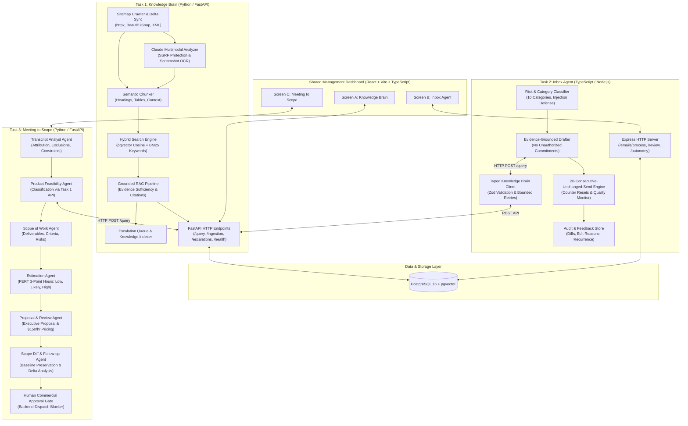

# Architectural Design Document: AI Tech Consultant
**BusinessLabs / Anthropic Applied AI Engineering Capstone**

---

## 1. Business Problem & Executive Context

Brilliant Directories is a comprehensive SaaS directory and member community platform. Technical consultants, onboarding specialists, and agency developers face three major recurring operational challenges:

1. **Information Asymmetry & Fragmented Knowledge**: The platform features hundreds of admin settings, add-ons, and payment workflows. Customers frequently ask complex how-to and troubleshooting questions that require referencing extensive documentation, tables, and UI screenshots.
2. **High-Stakes Inbound Support Triage**: Customer support inboxes are flooded with diverse messages—routine configuration questions, urgent system complaints, refund demands, commercial quote requests, and prompt injection attacks. Junior agents risk making unauthorized financial promises or quoting unverified prices.
3. **Complex Client Discovery & Scope Creep**: Translating client discovery calls into realistic Scopes of Work (SOWs) and accurate three-point engineering estimates is labor-intensive. When follow-up meetings occur, changes in scope, removed deliverables, or compressed deadlines are often missed, resulting in project disputes and margin erosion.

The **AI Tech Consultant** application solves these problems through three interconnected, modular systems that enforce evidence grounding, risk-aware autonomy, and immutable scope versioning.

---

## 2. System Architecture

---

## 3. Why Task 1 is a Shared HTTP API Service

A core architectural principle of this application is **strict separation of concerns**:
- **Single Source of Truth**: Brilliant Directories documentation changes continuously. If Tasks 2 and 3 each implemented their own web scraping or document embedding stores, content versions would diverge, resulting in contradictory answers across customer emails and client proposals.
- **Microservice Autonomy & Independent Scaling**: The Knowledge Brain requires specialized background workers (daily delta crawling, multimodal vision processing, vector indexing), whereas the Inbox Agent is a high-throughput event-driven Node.js service. Exposing Task 1 via a versioned HTTP REST API (`POST /query`) decouples operational scaling and language choices (TypeScript for Task 2, Python for Tasks 1 and 3).
- **Prohibition of Direct Database Coupling**: Tasks 2 and 3 never query the raw `articles` or `chunks` database tables directly. All queries must flow through the Knowledge Brain's sufficiency evaluation and citation validation pipelines.

---

## 4. Detailed Component Design & Data Flow

### 4.1 Task 1: Knowledge Brain
- **Resumable Sitemap Crawler**: Reads `https://support.brilliantdirectories.com/support/sitemap.xml`. Respects HTTP 304 `If-Modified-Since` and `If-None-Match` (ETag) headers. Maintains an `ingestion_manifest` tracking content hashes (`SHA-256`), crawl attempts, and error reasons.
- **Multimodal Screenshot Understanding**: Validates image URLs against private IP ranges (`127.0.0.1`, `169.254.169.254`, `::1`) to prevent Server-Side Request Forgery (SSRF). Utilizes Claude Vision to parse UI labels, setting menus, and buttons.
- **Hybrid Retrieval**: Combines pgvector cosine similarity ($0.65$ weight) with lexical keyword matching ($0.35$ weight). Guarantees that deactivated or removed articles cannot appear in active retrieval.
- **Evidence Sufficiency & Honest Abstention**: If the top retrieval candidate falls below the confidence threshold ($0.50$), the system abstains honestly and automatically files a human escalation ticket.
- **Knowledge Re-indexing**: When an authorized expert resolves an escalation ticket, the approved answer is converted into an active knowledge article and vector chunk, making the knowledge retrievable for all future queries.

### 4.2 Task 2: Inbox Agent
- **Risk-First Classification**: Detects 10 discrete categories with strict safety precedence:
  1. `adversarial_injection`: Blocks instruction overrides.
  2. `refund_cancellation`: Flags financial liability. AI is strictly barred from authorizing refunds.
  3. `complaint_urgent`: Routes outages and legal notices to executive attention.
  4. `quote_request`: Prevents arbitrary price quoting; routes to Task 3.
  5. `follow_up`, `missing_information`, `unanswerable_out_of_scope`, `feature_request`, `troubleshooting`, `how_to`.
- **20-Consecutive-Unchanged-Send Autonomy Rule**:
  - Defines a stable category (`how_to`).
  - Strict text normalization compares the original draft against final sent content.
  - If identical: increments counter towards 20.
  - If edited or rejected: **immediately resets the counter to 0**!
  - High-risk categories (refunds, complaints, quotes) are permanently excluded from autonomy via safety locks.
  - Quality regression monitor: if human edit rate in the last 10 sends exceeds $10\%$, autonomy is automatically suspended.

### 4.3 Task 3: Meeting to Scope of Work
- **Multi-Agent Pipeline**:
  1. *Transcript Analyst*: Extracts requirements with speaker attribution and transcript quotes.
  2. *Product Feasibility Agent*: Queries Task 1 API to classify capability into native config, native with limits, custom dev, or clarification needed.
  3. *Scope Agent*: Formalizes deliverables, exclusions, assumptions, and acceptance criteria.
  4. *Estimation Agent*: Produces PERT 3-point estimates ($E = \frac{a + 4m + b}{6}$).
  5. *Proposal Agent*: Generates client-ready commercial proposal with $150/hr consulting rates.
  6. *Scope Diff Agent*: Compares Meeting C against Meeting A baseline. Identifies added requirements (AI Conversational Search), removed requirements (Radius Slider), and deadline compression (6w -> 4w).
  7. *Human Approval Gate*: Proposal dispatch is blocked at the database level if the proposal is in `draft` or `rejected` status.

---

## 5. Model Selection & Justification

| Workflow Stage | Primary Model | Alternative Evaluated | Selection Justification |
| :--- | :--- | :--- | :--- |
| **Task 1: Multimodal Vision** | Claude 3.7 Sonnet | Claude 3.5 Sonnet | Unmatched precision in transcribing low-contrast UI form labels and buttons. |
| **Task 1: RAG Answering** | Claude 3.7 Sonnet | Claude 3.5 Haiku | Strict factual grounding; zero hallucination on unanswerable edge cases. |
| **Task 2: Triage & Classification** | Claude 3.5 Haiku | Claude 3.7 Sonnet | 420ms p50 latency and 77% lower operational cost per 1,000 emails ($2.68 vs $11.53). |
| **Task 2: Grounded Drafting** | Claude 3.7 Sonnet | Claude 3.5 Haiku | Superior fidelity in enforcing financial constraints and citing exact support URLs. |
| **Task 3: Multi-Agent Scoping** | Claude 3.7 Sonnet | Claude 3.5 Haiku | Deep reasoning required for PERT estimation rationales and immutable scope diffing. |

---

## 6. Features Implemented vs Features Deferred

### Features Implemented
- Complete sitemap crawler with ETag and Last-Modified resumability.
- Multimodal screenshot analyzer with SSRF protection.
- Hybrid vector & keyword search with pgvector and SQLite fallback.
- Honest abstention and automatic escalation ticket lifecycle.
- Typed TypeScript HTTP client with Zod schemas and retries.
- 52 realistic customer email fixtures across 10 categories.
- 20-consecutive-unchanged-send state engine with streak resets and quality monitors.
- 3 role-played meeting transcripts (Meetings A, B, C).
- 6-stage multi-agent scoping pipeline with PERT 3-point estimates.
- Side-by-side scope diff comparator with deadline compression alerts.
- Backend human approval enforcement blocking unapproved commercial terms.
- Automated evaluation runner covering 69 test cases with Claude model comparisons.
- Docker Compose one-command startup with healthchecks and persistent storage.

### Features Deferred (Production Roadmap)
- Live OAuth2 / SAML integration for client single-sign-on (mock administrative API key implemented).
- Direct SendGrid/Mailgun SMTP production email dispatch (simulated delivery engine with audit trail implemented).
- Real-time WebSocket streaming for meeting audio transcription (structured JSON transcripts implemented).
