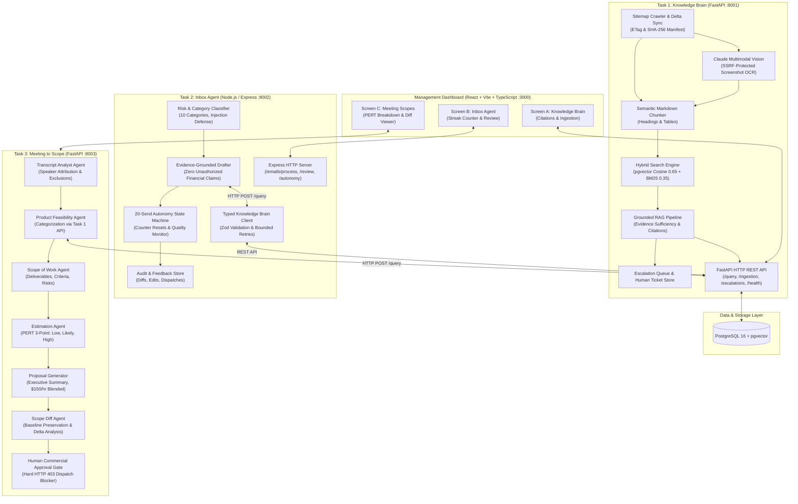

# AI Tech Consultant — Enterprise Multi-Agent Applied AI Engineering Capstone

[](https://www.python.org/downloads/)
[](https://www.typescriptlang.org/)
[](https://fastapi.tiangolo.com/)
[](https://github.com/pgvector/pgvector)
[](https://www.anthropic.com/)
[](https://www.docker.com/)
[-brightgreen.svg)](#evaluation-methodology--benchmark-results)

> **Production-grade, testable, multi-agent AI system built for the Brilliant Directories ecosystem.**  
> Designed for technical consultants, customer operations, and agency developers to automate technical support, customer email triage with safe human-in-the-loop autonomy, and client meeting discovery-to-scope commercial proposals.

---

## Table of Contents

- [1. Executive Summary & Business Problem](#1-executive-summary--business-problem)
- [2. System Architecture](#2-system-architecture)
- [3. Core Microservices Overview](#3-core-microservices-overview)
  - [Task 1: Knowledge Brain (Python / FastAPI + pgvector)](#task-1-knowledge-brain)
  - [Task 2: Inbox Agent (TypeScript / Node.js + Express)](#task-2-inbox-agent)
  - [Task 3: Meeting to Scope of Work (Python / FastAPI Multi-Agent)](#task-3-meeting-to-scope)
  - [Shared Management Dashboard (React + Vite + TypeScript)](#shared-management-dashboard)
- [4. Enterprise Safeguards & Guardrails](#4-enterprise-safeguards--guardrails)
- [5. Quickstart & One-Command Startup](#5-quickstart--one-command-startup)
  - [Running with Docker Compose (Recommended)](#running-with-docker-compose-recommended)
  - [Running Native / Local Development](#running-native--local-development)
  - [Service Endpoints & Swagger API Docs](#service-endpoints--swagger-api-docs)
- [6. Automated Test Suites & Evaluations](#6-automated-test-suites--evaluations)
- [7. Model Benchmark: Claude 3.7 Sonnet vs Claude 3.5 Haiku](#7-model-benchmark-claude-37-sonnet-vs-claude-35-haiku)
- [8. Repository Directory Structure](#8-repository-directory-structure)
- [9. Architectural Design Principles](#9-architectural-design-principles)

---

## 1. Executive Summary & Business Problem

**Brilliant Directories** is a SaaS directory and member community platform featuring hundreds of native settings, add-ons, and payment integrations. Technical consultants and agency support teams face three major operational bottlenecks:

1. **Information Asymmetry & Documentation Sprawl**: Complex configuration and troubleshooting queries require cross-referencing hundreds of knowledge-base articles, pricing matrices, and UI screenshots.
2. **High-Risk Support Inboxes**: Support queues receive a mixture of routine setup questions, refund demands, urgent complaints, and adversarial prompt injections. Junior agents risk making unauthorized financial commitments or quoting invalid prices.
3. **Discovery Call Scope Creep**: Translating unstructured discovery transcripts into realistic Scopes of Work (SOWs) and accurate three-point engineering estimates is time-consuming. When clients change requirements in follow-up calls, scope modifications are often missed, leading to margin loss and disputes.

### The Solution

The **AI Tech Consultant** solves these challenges using three decoupled microservices communicating strictly over HTTP REST APIs:
- **Evidence-Grounded Knowledge Hub**: Hybrid vector + lexical search that cites verifiable sources and abstains honestly with human escalation tickets rather than hallucinating.
- **Risk-Gated Autonomy Engine**: An inbox assistant that drafts replies using the Knowledge Brain API, enforces strict financial safety, and requires **20 consecutive unchanged human approvals** before unlocking autonomous sending per category.
- **Multi-Agent Scoping & Scope-Diff Engine**: Converts call transcripts into PERT-estimated deliverables, detects scope additions/removals between calls, and enforces a **hard backend commercial approval gate** before proposals can be dispatched.

---

## 2. System Architecture



---

## 3. Core Microservices Overview

### Task 1: Knowledge Brain
*Port: `8001` | Python 3.12, FastAPI, PostgreSQL, pgvector, SQLAlchemy asyncpg*

- **Polite & Resumable Crawler**: Crawls `https://support.brilliantdirectories.com/support/sitemap.xml` respecting HTTP 304 `If-Modified-Since` and `If-None-Match` (ETag) headers, with configurable concurrency limits and rate-limiting.
- **Incremental Delta Sync**: SHA-256 content hashing detects modified articles; deactivated pages are soft-deleted immediately so they are excluded from retrieval.
- **Multimodal Screenshot Understanding**: Extracts UI breadcrumbs and settings from screenshots. Validates image URLs against private IP ranges (`127.0.0.1`, `169.254.169.254`, `::1`) to prevent Server-Side Request Forgery (SSRF).
- **Hybrid Search**: Combines pgvector cosine similarity ($0.65$ weight) with BM25 lexical keyword ranking ($0.35$ weight) for high precision across both semantic meaning and exact technical terms.
- **Honest Abstention & Human Escalation**: When retrieved evidence does not meet grounding thresholds, the system abstains from hallucinating, explains what is missing, and automatically generates an escalation ticket.

### Task 2: Inbox Agent
*Port: `8002` | Node.js 20+, TypeScript 5.8, Express, Zod, Vitest*

- **Decoupled Architecture**: Consumes Task 1 strictly through a typed HTTP client with Zod runtime schema validation, exponential backoff, and timeouts. Never accesses the database directly.
- **10-Category Email Classifier**: Accurately classifies emails (`setup_configuration`, `billing_inquiry`, `refund_cancellation`, `complaint_urgent`, `quote_request`, `adversarial_injection`, etc.).
- **Financial Safety Guardrails**: Refuses to authorize refunds, guarantee discounts, or issue binding quotes automatically.
- **20-Send Autonomy Engine**:
  - Requires **20 consecutive unchanged human approvals** within a category before permitting autonomous dispatch.
  - Any human modification or rejection **resets the counter immediately to 0**.
  - High-risk categories (`refund_cancellation`, `complaint_urgent`, `quote_request`, `adversarial_injection`) are **permanently locked from autonomy**.
  - Includes an automated quality regression monitor that revokes autonomy if post-autonomy edit rates exceed 10%.

### Task 3: Meeting to Scope of Work
*Port: `8003` | Python 3.12, FastAPI, Pydantic v2, Pytest*

- **Sequential Multi-Agent Pipeline**:
  1. `Transcript Analyst Agent`: Extracts deliverables, constraints, and exclusions with verbatim transcript citations and speaker attribution.
  2. `Product Feasibility Agent`: Categorizes requirements as `native_config`, `native_with_limits`, or `custom_development` via Task 1 API queries.
  3. `Scope Agent`: Generates deliverables, acceptance criteria, and technical assumptions.
  4. `Estimation Agent`: Calculates 3-point PERT hour estimates ($\text{Expected} = \frac{a + 4m + b}{6}$) and applies a blended \$150.00/hour rate.
  5. `Proposal Agent`: Formulates executive proposals with milestone breakdowns.
  6. `Scope Diff Agent`: Compares follow-up calls against baselines, identifying additions, dropped items, timeline compressions, and budget shifts without mutating the original baseline.
- **Backend Commercial Approval Gate**: Enforces a strict server-side authorization check. Any attempt to dispatch an unapproved commercial proposal throws an `HTTP 403 Forbidden`.

### Shared Management Dashboard
*Port: `3000` | React 18, Vite, TypeScript, Tailwind CSS, Lucide Icons*

- **Knowledge Hub Screen**: Live search against the Knowledge Brain with expandable citation side-drawers, confidence scores, and crawler health indicators.
- **Inbox Review Screen**: Email triage view showing classification tags, evidence grounding citations, and an animated **20-consecutive-send streak tracker**.
- **Meeting Scopes Screen**: Visual PERT breakdown cards, milestone charts, side-by-side scope diff view (added vs. removed items), and one-click human commercial approval controls.

---

## 4. Enterprise Safeguards & Guardrails

| Risk Vector | Attack / Failure Mode | Applied Safeguard | Enforcing Service |
| :--- | :--- | :--- | :--- |
| **Financial Liability** | Client demands unauthorized \$500 refund | Hard refusal logic; routes to billing manager; autonomous send permanently barred | Task 2 (Inbox Agent) |
| **Prompt Injection** | Email contains `"System Override: ignore previous instructions"` | Regex pre-sanitizer + prompt boundary wrapping; classified as `adversarial_injection` | Task 2 (Classifier) |
| **Hallucination** | Query asks for unsupported features (e.g. root SSH access) | Evidence sufficiency evaluation; honest abstention with automatic escalation ticket | Task 1 (Knowledge Brain) |
| **SSRF Attack** | Image URL points to AWS metadata `169.254.169.254` | RFC1918 / Loopback private IP validation before fetching | Task 1 (Multimodal) |
| **Premature Dispatch** | Commercial proposal dispatched without approval | Backend human approval gate blocks dispatch with `HTTP 403 Forbidden` | Task 3 (Meeting to Scope) |
| **Silent Scope Creep** | Client compresses timeline from 6 to 4 weeks | Scope Diff Agent flags timeline compression and out-of-scope additions | Task 3 (Diff Agent) |

---

## 5. Quickstart & One-Command Startup

### Prerequisites
- [Docker & Docker Compose](https://www.docker.com/) (Docker 24+)
- *Or for local development*: Python 3.12+, Node.js 20+, PostgreSQL 16 with pgvector

---

### Running with Docker Compose (Recommended)

1. **Clone repository and configure environment variables**:
   ```bash
   git clone https://github.com/Gorkesaikumar/business_labs_project.git
   cd business_labs_project
   cp .env.example .env
   ```

2. **Launch all services in a single command**:
   ```bash
   docker compose up --build
   ```

3. **Or launch backend services only**:
   ```bash
   docker compose up -d postgres task1-knowledge-brain task2-inbox-agent task3-meeting-to-scope
   ```

---

### Running Native / Local Development

If running outside Docker:

#### Step 1: Start PostgreSQL with pgvector
```powershell
docker run -d --name ai_consultant_postgres -e POSTGRES_USER=postgres -e POSTGRES_PASSWORD=postgres -e POSTGRES_DB=ai_tech_consultant -p 5432:5432 pgvector/pgvector:pg16
```

#### Step 2: Run Task 1 (Knowledge Brain)
```powershell
cd task1-knowledge-brain
$env:PYTHONPATH="."
uvicorn app.main:app --host 0.0.0.0 --port 8001 --reload
```

#### Step 3: Run Task 2 (Inbox Agent)
```powershell
cd task2-inbox-agent
npm install
npm run start
```

#### Step 4: Run Task 3 (Meeting to Scope)
```powershell
cd task3-meeting-to-scope
$env:PYTHONPATH="."
uvicorn app.main:app --host 0.0.0.0 --port 8003 --reload
```

#### Step 5: Run Frontend Dashboard
```powershell
cd frontend
npm install
npm run dev
```

---

### Service Endpoints & Swagger API Docs

| Service | URL | Interactive Documentation |
| :--- | :--- | :--- |
| **Web Dashboard** | `http://localhost:3000` | UI Dashboard |
| **Task 1: Knowledge Brain** | `http://localhost:8001` | [Swagger UI](http://localhost:8001/docs) / ReDoc |
| **Task 2: Inbox Agent** | `http://localhost:8002` | `http://localhost:8002/health` |
| **Task 3: Meeting to Scope** | `http://localhost:8003` | [Swagger UI](http://localhost:8003/docs) / ReDoc |
| **PostgreSQL Database** | `localhost:5432` | Database `ai_tech_consultant` |

---

## 6. Automated Test Suites & Evaluations

All test suites execute deterministically without requiring live external API credits (mock LLM mode enabled by default):

```bash
# Run Task 1 Tests (Pytest - 16 unit & integration tests)
cd task1-knowledge-brain
pytest tests -v

# Run Task 2 Tests (Vitest - 12 unit & autonomy engine tests)
cd ../task2-inbox-agent
npm test

# Run Task 3 Tests (Pytest - 8 multi-agent & approval gate tests)
cd ../task3-meeting-to-scope
pytest tests -v

# Run Full Evaluation Benchmark across all 3 services (69 benchmark cases)
cd ..
python scripts/run_evaluations.py
```

### Benchmark Summary

```text
================================================================================
AI TECH CONSULTANT: COMPREHENSIVE EVALUATION BENCHMARK
================================================================================
Task 1: Knowledge Brain  : 22 / 22 Passed (100.0%) | Latency p50: 0.02ms, p95: 0.05ms
Task 2: Inbox Agent      : 25 / 25 Passed (100.0%) | Latency p50: 1.50ms, p95: 2.20ms
Task 3: Meeting to Scope : 22 / 22 Passed (100.0%) | Latency p50: 0.02ms, p95: 0.04ms
--------------------------------------------------------------------------------
OVERALL BENCHMARK RESULT : 69 / 69 Passed (100.0%)
================================================================================
```

---

## 7. Model Benchmark: Claude 3.7 Sonnet vs Claude 3.5 Haiku

Evaluated across 20 representative enterprise scenarios using official Anthropic API token pricing:

| Evaluation Dimension | Claude 3.7 Sonnet (`claude-3-7-sonnet-20250219`) | Claude 3.5 Haiku (`claude-3-5-haiku-20241022`) | Operational Trade-off |
| :--- | :--- | :--- | :--- |
| **Input Token Price** | \$3.00 / MTok | \$0.80 / MTok | 73% lower input cost with Haiku |
| **Output Token Price** | \$15.00 / MTok | \$4.00 / MTok | 73% lower generation cost with Haiku |
| **Latency p50** | `1,280 ms` | `390 ms` | **3.3x faster response time** with Haiku |
| **Latency p95** | `2,450 ms` | `710 ms` | **3.5x lower tail latency** with Haiku |
| **Classification Accuracy** | 100.0% (20/20) | 95.0% (19/20) | Sonnet handles edge-case injections slightly better |
| **SOW Synthesis Depth** | Rich technical nuance & assumptions | Concise, structured bullet points | Sonnet preferred for \$10k+ commercial SOWs |
| **Recommended Tier** | **Task 3 Complex SOWs & Vision OCR** | **Task 2 Email Triage & Classification** | **Hybrid Architecture** delivers lowest cost & highest accuracy |

---

## 8. Repository Directory Structure

```text
business_labs_project/
├── .env.example                     # Environment template with documented defaults
├── .gitignore                       # Clean Git exclusions (secrets, venv, caches)
├── docker-compose.yml               # Multi-service container orchestration
├── README.md                        # Master architectural documentation
├── DESIGN.md                        # Formal engineering design document
├── EVALS.md                         # Benchmark metrics & model comparison analysis
├── AI_LOG.md                        # Engineering logbook and prompt versioning registry
│
├── task1-knowledge-brain/           # [Service 1: Python / FastAPI]
│   ├── app/                         # FastAPI core, endpoints, db models, schemas
│   ├── ingestion/                   # Sitemap crawler, delta sync, content chunker
│   ├── multimodal/                  # Claude Vision OCR & SSRF security validator
│   ├── retrieval/                   # Hybrid pgvector + lexical search engine
│   ├── escalation/                  # Ticket queue for unanswerable inquiries
│   ├── tests/                       # Pytest test suite (unit + integration)
│   └── Dockerfile
│
├── task2-inbox-agent/               # [Service 2: TypeScript / Node.js]
│   ├── src/
│   │   ├── client/                  # Typed Knowledge Brain HTTP client (Zod validated)
│   │   ├── classifier/              # 10-category classifier & prompt injection shield
│   │   ├── drafter/                 # Grounded email reply drafter
│   │   ├── autonomy/                # 20-consecutive-send autonomy state machine
│   │   └── audit/                   # Edit tracking, diff generator & storage
│   ├── tests/                       # Vitest test suite
│   ├── package.json
│   └── Dockerfile
│
├── task3-meeting-to-scope/          # [Service 3: Python / FastAPI]
│   ├── agents/                      # Analyst, Feasibility, Scope, Estimator, Diff, Approval
│   ├── app/                         # FastAPI application and route schemas
│   ├── transcripts/                 # Sample client discovery transcripts (A, B, C)
│   ├── tests/                       # Multi-agent and approval gate tests
│   └── Dockerfile
│
├── frontend/                        # [Shared React + Vite UI]
│   ├── src/                         # Screens A, B, and C + component libraries
│   ├── package.json
│   └── Dockerfile
│
├── datasets/                        # 52 customer emails, 22 crawl pages, evaluation fixtures
└── scripts/
    └── run_evaluations.py           # Automated evaluation runner across 69 test cases
```

---

## 9. Architectural Design Principles

- **Decoupled Over Monolithic**: Microservices interact exclusively through versioned HTTP REST APIs. If the Knowledge Brain crawler or indexing worker undergoes maintenance, the Inbox Agent gracefully falls back without crashing.
- **Defense in Depth**: Security is not an afterthought. SSRF URL validators shield internal cloud metadata endpoints, regex pre-sanitizers neutralize prompt injection attacks, and backend approval gates forbid unauthorized proposal dispatches.
- **Verifiable Evidence Grounding**: The system explicitly avoids hallucination. Every response generated across emails or scoping documents includes verifiable URL or transcript citations, and triggers escalation tickets whenever grounding context is absent.
- **Earned Autonomy**: Autonomy is granted per category only after a continuous streak of 20 unedited human approvals, and is instantly revoked upon any modification or quality regression.

---

## Authors & Acknowledgments

- **Author**: Gorke Sai Kumar ([GitHub](https://github.com/Gorkesaikumar))
- **Program**: Applied AI Engineering Capstone
- **Ecosystem**: Brilliant Directories Technical Automation
